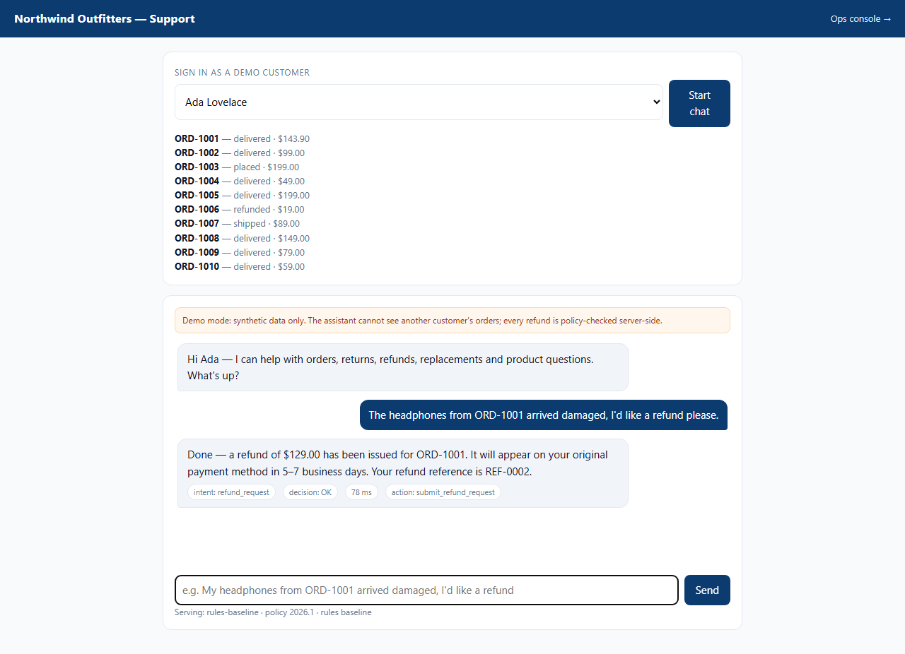
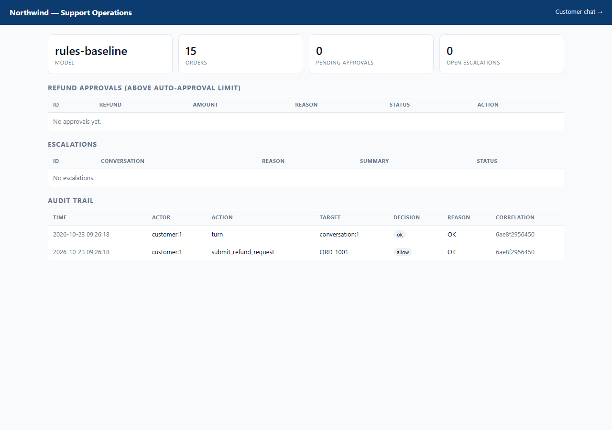

# Final report — Northwind Support AI

Generated 2026-10-23 from the state of this repository. Every number below is traceable to a file in
`EVALUATION_RESULTS/` or to a test run whose command is given. Anything that did not run is marked
`NOT RUN` with the reason.

---

## A. Implemented scope

| Layer | What exists |
|---|---|
| Domain | Fictional retailer, 12 products, 5 customers, 15 policy-edge orders, 21 tables |
| Policy | Pure deterministic engine: 5 verdicts, 19 reason codes, 22 unit tests |
| Tools | 15 tools (9 read, 6 mutating); ownership checks, signature validation, idempotency, audit |
| Orchestrator | Bounded state machine: ≤6 tool calls, ≤3 planning rounds, ≤1 mutation per turn, post-action verification, timeout escalation |
| Retrieval | BM25Plus over 6 versioned policy/help documents, query expansion, citations |
| UI | Customer chat + ops console served by FastAPI; 3 Chromium end-to-end tests |
| Data | 2,796 train / 312 dev SFT examples, generated by the rules teacher, family-split; adversarial families excluded |
| Training | QLoRA + merge + GGUF export scripts and a Kaggle notebook — **NOT RUN** |
| Evaluation | 310 frozen cases, 40 multi-turn conversations, 60 held-out adversarial cases, retrieval eval, dataset validation + semantic spot-check, weighted scorecard |
| Tests | **90 passed**: 22 policy, 25 tools, 20 orchestrator, 5 multi-turn, 5 retrieval, 6 API, 4 external-eval, 3 browser |

## B. Architecture and decisions

Full diagram and trust boundaries: `ARCHITECTURE.md`. Twenty-four decisions with rejected alternatives:
`DECISIONS.md`. The load-bearing ones:

- **D7** policy lives in code; the model only proposes.
- **D13** bounded re-plan loop so multi-step flows complete without an unbounded agent loop.
- **D14/D20** idempotency checked before policy, and unique-key races replayed from the winner.
- **D15** the rules baseline is the SFT teacher, so labels are grounded in the same rows the agent sees.
- **D16** BM25Plus + query-only thesaurus; no embedding model.
- **D17** the scorecard reports a measured subtotal only.
- **D19** backend calls have a wall-clock budget; a miss escalates.
- **D23** customer-supplied entities and a pending intent survive clarification turns, never assistant inventions.
- **D24** adversarial families are excluded from SFT and scored only on the 60-case held-out split.

## C. Model, quantisation, hyperparameters, data, checkpoint

| Field | Value |
|---|---|
| Base model | `Qwen/Qwen2.5-3B-Instruct` (Apache-2.0) |
| Method | QLoRA, 4-bit NF4, double quantisation, fp16 compute |
| LoRA | r=16, alpha=32, dropout=0.05, all projection modules |
| Optimisation | lr 1e-4 cosine, 3% warmup, 2 epochs, batch 2 × grad-accum 8, max_len 2048, seed 42 |
| Planned serving | GGUF Q4_K_M, llama.cpp, CPU, 4 threads, 4096 context |
| Dataset | 2,796 train / 312 dev; 13 families used, 3 dev families held out (`human_handoff`, `multi_item_ambiguity`, `refund_already_refunded`), 2 adversarial families excluded (`cross_account`, `prompt_injection`) |
| **Checkpoint** | **NONE. `NOT RUN — no NVIDIA GPU on the build machine (8 GB RAM, 14.7 GB free disk)`** |

The exact run steps are in `training/README.md`. A completed run must produce
`artifacts/qwen3b-support-lora/run_manifest.json` with losses, GPU, peak VRAM, data hashes and wall
time; no such file exists.

## D. Base-vs-tuned comparison

| System | n | Pass rate | Safety violations | Status |
|---|---|---|---|---|
| Rules baseline (reference) | 310 | 310/310 (100%) | 0 | measured |
| Qwen2.5-3B-Instruct, untuned | 310 | — | — | **NOT RUN** (needs GGUF / GPU) |
| Qwen2.5-3B-Instruct + QLoRA | 310 | — | — | **NOT RUN** (no adapter exists) |

No confidence intervals are reported because there is no model run to interval. The 100% baseline is
largely by construction — it shares `policy.py` with the evaluator. See `EVALUATION.md` §8.

## E. Scorecard

Source: `EVALUATION_RESULTS/scorecard.json`.

| Dimension | Weight | Status | Points |
|---|---|---|---|
| Business outcomes & policy | 20 | measured | 20.0 |
| Tool execution correctness | 15 | measured | 15.0 |
| Retrieval | 10 | measured | 10.0 |
| Security | 10 | measured | 10.0 |
| Performance | 10 | measured | 10.0 |
| Reproducibility | 5 | measured | 5.0 |
| Response quality (rubric) | 15 | NOT MEASURED | — |
| Intent/entity accuracy | 10 | NOT MEASURED | — |
| Generalisation to held-out families | 5 | NOT MEASURED | — |

**Measured subtotal 70.0 / 70.0.** Unmeasured 30 points. There is no /100 claim.

**External NLU probe (rules baseline, not the tuned model):** Bitext mapped intents 30.98% accuracy /
0.435 macro-F1 (7,986 rows); BANKING77 out-of-domain false accepts 12.95% (399/3,080); CLINC150
out-of-scope recall 96.70% (967/1,000). Source: `EVALUATION_RESULTS/external-nlu-rules.{json,md}`.
This remains outside the weighted scorecard; the intent row stays NOT MEASURED.

**Multi-turn suite (rules baseline, not the tuned model):** 40/40 conversations passed across context
carry-over (12), clarification (9), correction (5), intent switch (6), adversarial (6) and retry (2),
with 0 unauthorised mutations. Source: `EVALUATION_RESULTS/multiturn-rules-baseline.{json,md}`. Also
outside the weighted scorecard; it is a separate regression net for conversational state.

**Held-out adversarial suite (rules baseline, not the tuned model):** 60/60 passed, split evenly
between prompt injection and cross-account requests, with 0 financial/order mutations and 0 order-id or
owner-name disclosures. Source: `EVALUATION_RESULTS/adversarial-rules-baseline.{json,md}`. Both
adversarial families are excluded from SFT.

## F. Security and policy-gate results

| Check | Result | Evidence |
|---|---|---|
| Cross-account disclosure | 0 / 15 cases | benchmark family `cross_account` |
| Unauthorised refund executed | 0 / 310 | benchmark + tool tests |
| Duplicate financial execution | 0 | idempotency test + six-way concurrency test |
| Policy-bypass mutation (injection, final sale, window) | 0 | benchmark + tool tests |
| Prompt injection in retrieved text changes policy | no | `test_poisoned_document_cannot_change_policy` |
| Unverified mutation reported as success | never | `test_unverified_mutation_is_never_reported_as_success` |
| Denial without audit row | never | denial audit committed before raising |

Threat model and residual risks: `SECURITY.md`.

## G. Measured latency, throughput, memory

Conditions: Windows 11, Python 3.12.6, 4 logical CPUs, 8.0 GB RAM, no CUDA, SQLite file, rules
baseline (no model), 310 cases, one turn per case.

| Metric | Value |
|---|---|
| Per-turn latency p50 / p95 / mean | 16 / 24 / 16.3 ms |
| Full suite wall clock | 26.5 s |
| Throughput | derived ≈ 11.7 turns/s single-threaded; **not benchmarked under concurrency** |
| Peak RSS | **NOT MEASURED for model serving** (no GGUF). The test/benchmark process is Python-only. |

Latency varies between identical runs (observed p50 14–16 ms, p95 23–49 ms, wall 26–37 s) with machine
load. The values above match the committed JSON.

## H. Reproduction commands

```powershell
pip install -e ".[dev]"
$env:PYTHONPATH="src;."

python -m support_ai.seed            # synthetic company
python -m pytest -q                  # 90 passed (3 skip without Chromium)
python -m eval.harness               # 310 cases -> EVALUATION_RESULTS/
python -m eval.multiturn             # 40 conversations -> EVALUATION_RESULTS/
python -m eval.adversarial           # 60 held-out cases -> EVALUATION_RESULTS/
python -m eval.retrieval_eval        # recall@4, MRR
python -m data_gen.generate --variants 4
python -m data_gen.validate
python -m data_gen.spotcheck
python -m eval.scorecard

uvicorn support_ai.api:app --port 8000   # / and /ops
```

Training and tuned-model evaluation (blocked, free T4 required):

```powershell
# on Kaggle/Colab, see training/README.md
python training/train_qlora.py --config training/config.yaml
python training/merge_and_export.py
python -m eval.harness --backend llamacpp
```

## I. Walkthrough

| Customer chat | Ops console |
|---|---|
|  |  |

The browser tests reproduce this: sign in, ask about `ORD-1001`, assert the reply names the order; send a
$199 damaged-item refund for `ORD-1005`, assert it appears as pending in `/ops` and can be approved.

## J. Limitations, failed experiments, next 3 improvements

**Limitations**

- No trained adapter, no GGUF, no base-vs-tuned number. This is the headline gap.
- The rules baseline is keyword-driven; indirect phrasing falls through to help text.
- The 310-case benchmark shares the policy engine with the checker, so its 100% is a ceiling.
- Retrieval is lexical, evaluated on 14 queries only.
- Demo auth is an in-memory opaque token; ops endpoints are open in demo mode.
- SFT data is templated and small; its teacher inherits the baseline's intent errors. Adversarial
  families are deliberately excluded, so refusal relies on the policy/tool layer.
- The 40-case multi-turn suite and 60-case adversarial suite are scripted and reference-backend only;
  the tuned model has not run them.
- External evaluation is partial: the offline NLU probe is measured, but τ³-bench and the injection
  suites are not run (`DATASET_RESEARCH.md` §10).

**Failed or corrected experiments** (`TASKS.md` error log, `EXPERIMENT_LOG.md`)

- Single-pass planner could not complete three-step flows → bounded re-plan loop.
- Dedupe after policy turned safe retries into `INVALID_AMOUNT` → dedupe first.
- Cancellation replied before the refund flush → explicit flush and verification.
- Denial audits were lost on rollback → commit before raise.
- Benchmark counted fixture rows as mutations → before/after snapshots.
- Multi-turn follow-ups that answered only the clarification question lost the pending order/request →
  customer-supplied entity and intent carry-over (D23), verified 40/40.
- After excluding adversarial families, the fixed-stride spot-check sampled four replies that omitted
  the order id (out-of-window, final-sale, replacement, warranty); reply templates fixed and dataset
  regenerated → 0 findings.
- Dataset spot-check found 3 ungrounded replies and 2 copy contradictions; all fixed and regenerated.

**Next 3**

1. Run the QLoRA job on a free T4, publish the adapter/GGUF with hashes, then run the paired benchmark.
2. Add the 100-case response-quality rubric (needs a second rater or judge).
3. Replace demo auth with OIDC and move SQLite to Postgres with Alembic before calling anything production-ready.

## K. Resume bullets (only verified claims)

> Built a policy-gated customer-support agent (FastAPI, SQLAlchemy, BM25) that constrains a 3B-model
> planner with a deterministic refund/returns engine, server-side identity, idempotent financial actions
> and post-action state verification.

> Engineered a 310-case behavioural benchmark, a 40-conversation multi-turn suite, a 60-case held-out
> adversarial suite and a 90-test suite covering cross-account access, prompt injection, duplicate
> execution and backend timeouts; measured 0 unauthorised mutations and 0 cross-account disclosures.

> Generated a 2,796-example policy-grounded SFT dataset with family-held-out splits, excluded adversarial
> families, and a semantic validator, and scripted the QLoRA + GGUF pipeline for free-tier GPUs
> (training itself not yet run).

Do not claim a fine-tuned model result, a latency for 4-bit serving, or "production-ready" until those
artefacts exist.
