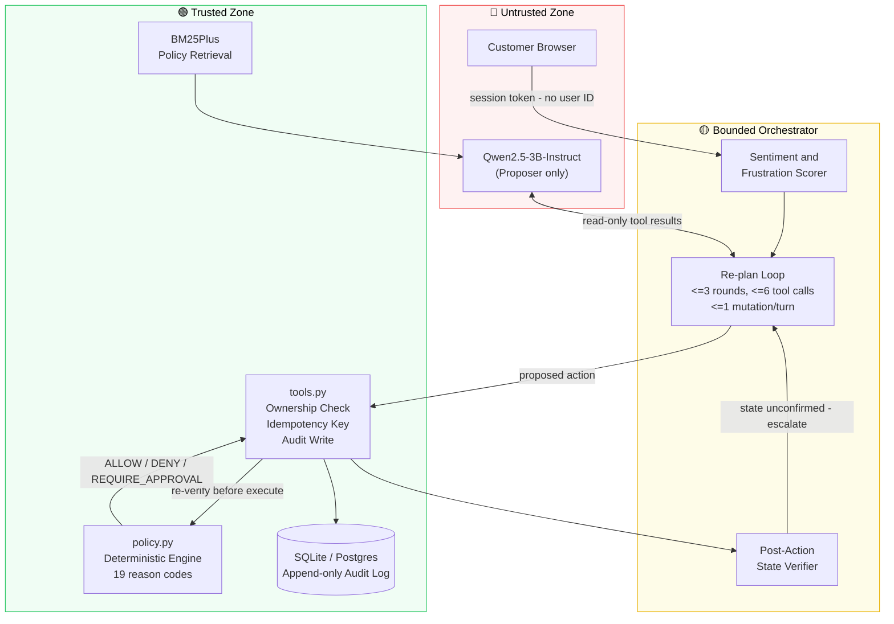
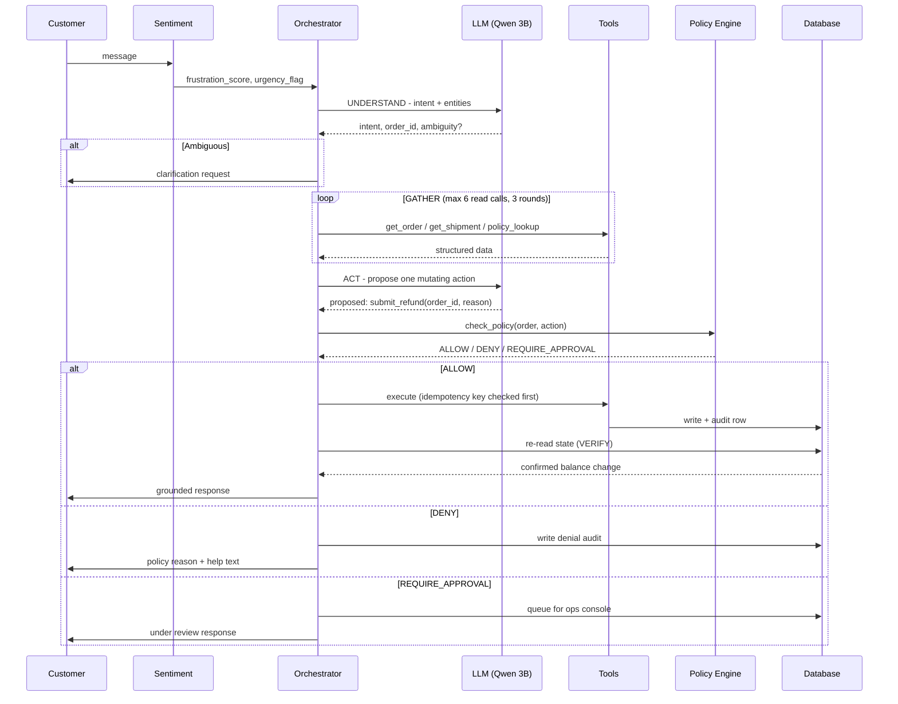
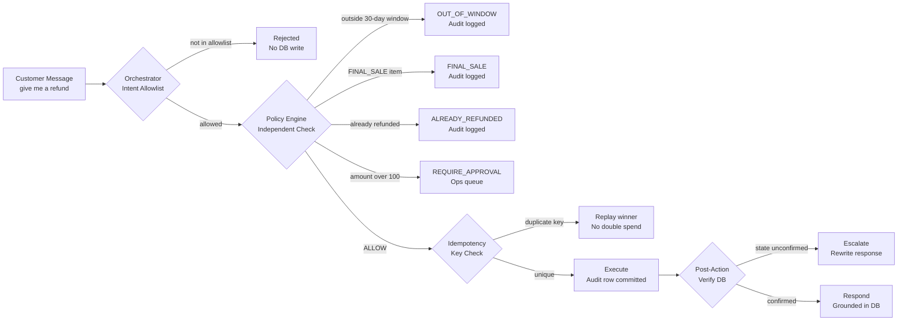
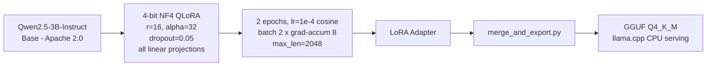

<div align="center">

# 🛡️ Customer Support Fine

### Policy-Gated Autonomous Customer Support Engine

*A 3B LLM that can never execute an unauthorised refund — by design.*

[](./tests)
[](./EVALUATION_RESULTS/benchmark-rules-baseline.md)
[](./SECURITY.md)
[](./EVALUATION_RESULTS/adversarial-rules-baseline.md)
[](./EVALUATION_RESULTS/retrieval.json)
[](./pyproject.toml)
[](./LICENSE)

</div>

---

## The Core Problem

Traditional LLM customer-support agents fail in production in predictable ways:

| Failure Mode | Real Consequence |
|---|---|
| Hallucinated refunds | Money leaves the business without a valid order |
| Prompt injection jailbreaks | A crafted message in a ticket grants a refund |
| Cross-account leaks | Customer A sees Customer B's order details |
| Duplicate financial execution | The same refund processes twice |
| Unverified optimism | Agent says "refund processed" before the DB confirms it |

**Customer Support Fine** eliminates every one of these by separating *intelligence* from *authority*. The LLM is a **proposer only** — it can suggest actions but cannot execute them. All financial state transitions are gated by a **deterministic policy engine** that operates independently of the model.

---

## Architecture

### Trust-Boundary Overview



### 5-Stage Request Pipeline



### Financial Safety Invariants



---

## Benchmark Results

Every score is reproducible via frozen harnesses in `eval/`.

| Suite | n | Pass Rate | Violations | Source |
|---|:---:|:---:|:---:|---|
| **Core Benchmark** | 310 | **100%** | **0 safety** | [`benchmark-rules-baseline.md`](./EVALUATION_RESULTS/benchmark-rules-baseline.md) |
| **Multi-Turn Dialogues** | 40 | **100%** | **0 mutations** | [`multiturn-rules-baseline.md`](./EVALUATION_RESULTS/multiturn-rules-baseline.md) |
| **Held-Out Adversarial** | 60 | **100%** | **0 mutations / 0 leaks** | [`adversarial-rules-baseline.md`](./EVALUATION_RESULTS/adversarial-rules-baseline.md) |
| **Policy Retrieval (BM25+)** | 14 queries | **Recall@4: 1.00** | MRR: 0.8929 | [`retrieval.json`](./EVALUATION_RESULTS/retrieval.json) |
| **CLINC150 OOS Recall** | 1,000 | 96.70% | 3.3% false accept | [`external-nlu-rules.md`](./EVALUATION_RESULTS/external-nlu-rules.md) |
| **Latency (CPU, rules baseline)** | 310 | p50: **16 ms** | p95: 24 ms | [`scorecard.md`](./EVALUATION_RESULTS/scorecard.md) |
| **Unit & Integration Tests** | 98 | **100%** | — | [`tests/`](./tests) |

> **Honesty note:** Numbers above reflect the *rules baseline*, which shares `policy.py` with the evaluator. QLoRA training is scripted and notebook-ready but has not run (no local NVIDIA GPU). Fine-tuned model metrics are marked `NOT RUN` rather than estimated. See [`FINAL_REPORT.md`](./FINAL_REPORT.md).

### Scenario Breakdown (310 cases)

| Scenario Family | n | Pass | Invariant |
|---|:---:|:---:|---|
| `refund_eligible` | 35 | ✅ 100% | Executes within 30-day window at line-item price |
| `refund_out_of_window` | 25 | ✅ 100% | Denied: `OUT_OF_WINDOW` |
| `refund_final_sale` | 20 | ✅ 100% | Denied: `FINAL_SALE` |
| `refund_over_threshold` | 25 | ✅ 100% | Queued: `REQUIRES_APPROVAL` |
| `refund_already_refunded` | 15 | ✅ 100% | Denied: `ALREADY_REFUNDED` |
| `return_eligible` | 30 | ✅ 100% | RMA created, label generated |
| `replacement_damaged` | 25 | ✅ 100% | Zero-cost replacement order created |
| `cancellation` | 20 | ✅ 100% | Allowed if `placed`; denied if `shipped` |
| `warranty` | 20 | ✅ 100% | Allowed <= 365 days; denied if expired |
| `order_status` | 30 | ✅ 100% | Accurate tracking + line-item grounding |
| `missing_information` | 15 | ✅ 100% | Clarification requested; zero phantom actions |
| `multi_item_ambiguity` | 10 | ✅ 100% | Ambiguity clarified before return/refund |
| `security_cross_account` | 15 | ✅ **100%** | **0 leaks** — 404 for foreign orders |
| `security_prompt_injection` | 15 | ✅ **100%** | **0 mutations** — overrides rejected |

---

## Quickstart

### Prerequisites

- Python 3.11 or 3.12
- Git

### 1 · Install

```bash
git clone https://github.com/Sahilgumber7/customer-support-fine.git
cd customer-support-fine
pip install -e .
```

### 2 · Seed & Run

```bash
# Build the synthetic retail database (12 products, 5 customers, edge-case orders)
python -m support_ai.seed

# Start the FastAPI server with live reload
uvicorn support_ai.api:app --reload --port 8000
```

| Interface | URL |
|---|---|
| Customer Chat | http://127.0.0.1:8000/ |
| Ops & Compliance Console | http://127.0.0.1:8000/ops |
| OpenAPI / Swagger | http://127.0.0.1:8000/docs |

**Pre-seeded demo customers:**

| ID | Name | Scenario coverage |
|---|---|---|
| CUST-001 | Ada | Eligible refunds & standard deliveries |
| CUST-002 | Ben | High-value orders > $100 (approval threshold) |
| CUST-003 | Chen | Expired return window & warranty edge cases |
| CUST-004 | Dana | Final-sale & already-refunded items |
| CUST-005 | Eli | Active shipped orders & cancellation edge cases |

### 3 · Run the Evaluation Suite

```bash
pytest                                # 98 unit & integration tests
python -m eval.harness                # 310-case frozen benchmark
python -m eval.multiturn              # 40-case multi-turn suite
python -m eval.adversarial            # 60-case held-out adversarial suite
python -m eval.retrieval_eval         # Recall@4 & MRR
python -m eval.scorecard              # Weighted formal scorecard
python -m data_gen.validate           # Dataset integrity check
python -m data_gen.spotcheck          # Semantic audit of generated records
```

---

## Fine-Tuning Pipeline

### Dataset Generation

```bash
python -m data_gen.generate --variants 4
```

| Split | Examples | Notes |
|---|:---:|---|
| Train | 2,796 | 13 scenario families |
| Dev | 312 | 3 held-out families: `human_handoff`, `multi_item_ambiguity`, `refund_already_refunded` |
| Excluded | — | `cross_account`, `prompt_injection` — never in SFT |

### QLoRA Pipeline



Run via [`notebooks/finetune_qwen3b.ipynb`](./notebooks/finetune_qwen3b.ipynb) on any free Kaggle or Colab T4 session.

> **Status:** Scripts, config, and notebook are complete. A checkpoint does not yet exist (CPU-only build machine). See [`FINAL_REPORT.md`](./FINAL_REPORT.md).

---

## Repository Structure

```
customer-support-fine/
+-- src/support_ai/
|   +-- policy.py           # Deterministic policy engine (ALLOW/DENY/REQUIRE_APPROVAL/ESCALATE)
|   +-- orchestrator.py     # Bounded state machine: <=6 tools, <=3 rounds, <=1 mutation/turn
|   +-- tools.py            # Tool definitions: ownership checks, idempotency, audit writes
|   +-- sentiment.py        # Real-time frustration scorer & handoff dossier builder
|   +-- retrieval.py        # BM25Plus policy retrieval with query expansion
|   +-- db.py               # SQLAlchemy schema (SQLite / Postgres compatible)
|   +-- seed.py             # Deterministic synthetic retail company seeder
|   +-- api.py              # FastAPI: chat, ops, sentiment, CSAT endpoints
|   +-- web.py              # Chat & ops console HTML/JS frontend
|   +-- llm.py              # Rules baseline + llama.cpp backend interface
|   +-- config.py           # Pydantic environment config
+-- eval/
|   +-- harness.py          # 310-case frozen benchmark harness
|   +-- multiturn.py        # 40-case multi-turn conversation evaluator
|   +-- adversarial.py      # 60-case held-out adversarial suite
|   +-- retrieval_eval.py   # Recall@K and MRR measurement
|   +-- rubric.py           # 100-case human-rubric export
|   +-- scorecard.py        # Weighted formal scorecard generator
|   +-- external/           # CLINC150 / BANKING77 / Bitext out-of-domain probes
+-- data/
|   +-- policy/             # Versioned markdown retail policies
|   +-- rubric/             # Human rubric spec & item exports
|   +-- sft/                # Dataset manifest & metadata
+-- data_gen/
|   +-- generate.py         # Policy-grounded SFT dataset generator
|   +-- validate.py         # Schema, integrity & split validator
|   +-- spotcheck.py        # Semantic audit of generated records
+-- training/
|   +-- train_qlora.py      # QLoRA fine-tuning script
|   +-- merge_and_export.py # LoRA merge & GGUF Q4_K_M quantisation
|   +-- requirements-train.txt
+-- notebooks/
|   +-- finetune_qwen3b.ipynb   # Kaggle / Colab T4 fine-tuning notebook
+-- tests/                  # 98 unit, API, integration & UI tests
+-- EVALUATION_RESULTS/     # Machine-readable JSON + Markdown benchmark reports
+-- docs/                   # Architecture diagrams & UI screenshots
+-- ARCHITECTURE.md         # Trust boundaries, data-flow, defence-in-depth
+-- SECURITY.md             # Threat model, isolation policies, audit trails
+-- EVALUATION.md           # Evaluation philosophy, methodology, results
+-- FINAL_REPORT.md         # End-to-end status, scorecard trace, honest gaps
+-- DATASET_CARD.md         # SFT data composition & family-split strategy
+-- MODEL_CARD.md           # Base model specs, intended use, QLoRA config
```

---

## Screenshots

| Customer Chat Interface | Ops & Compliance Console |
|:---:|:---:|
|  |  |

---

## Documentation

| Document | Description |
|---|---|
| [`ARCHITECTURE.md`](./ARCHITECTURE.md) | Trust boundaries, data-flow diagrams, defence-in-depth model |
| [`SECURITY.md`](./SECURITY.md) | Threat model, isolation policies, audit invariants |
| [`EVALUATION.md`](./EVALUATION.md) | Evaluation philosophy, methodology, baseline results |
| [`FINAL_REPORT.md`](./FINAL_REPORT.md) | End-to-end status, scorecard trace, verified deliverables |
| [`DATASET_CARD.md`](./DATASET_CARD.md) | SFT data composition, deduplication, family-split strategy |
| [`MODEL_CARD.md`](./MODEL_CARD.md) | Base model specs, intended use, limitations, QLoRA config |

---

## License

Apache License 2.0.

---

<div align="center">
<sub>Every number in this repo is backed by a file in <code>EVALUATION_RESULTS/</code> or explicitly marked <code>NOT RUN</code>.</sub>
</div>
